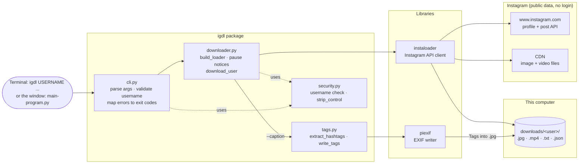
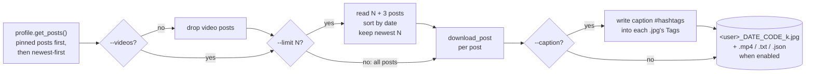

# igdl: Instagram post downloader

A terminal tool and desktop window that download a **public** Instagram profile's posts into a local folder. By default it saves **images only**. Videos, captions and metadata are each opt-in. With captions on, every `#hashtag` in a post's caption is also written into its images' **Tags**, which Windows shows under Properties → Details. It is built on [instaloader](https://instaloader.github.io/).

## Install

**PowerShell / cmd:**

```powershell
cd ig-scraper
python -m venv .venv
.venv\Scripts\pip install -e .[dev]
.venv\Scripts\activate          # then run igdl directly
```

**Git Bash** (use forward slashes, because bash treats `\` as an escape character):

```bash
cd ig-scraper
python -m venv .venv
source .venv/Scripts/activate   # then pip and igdl work directly
pip install -e ".[dev]"
```

On macOS or Linux, use `.venv/bin/activate` instead of `.venv/Scripts/activate`.

After activating, `igdl --help` should print the options. Run `deactivate` to leave the environment.

## Desktop window (GUI)

Prefer clicking to typing? With the virtual environment activated (see Install), run this from the `ig-scraper` folder:

```powershell
python main-program.py      # Windows
python3 main-program.py     # macOS / Linux
```

> **Windows:** use `python`, not `python3`. On Windows, `python3` usually opens the Microsoft Store instead of running Python.

The window has the same features as the `igdl` command:

| In the window | Same as |
|---------------|---------|
| Instagram username | `USERNAME` |
| Output folder (prefilled with `downloads` under the current folder) | `-o DIR` |
| ☐ Only the newest _N_ posts | `--limit N` |
| ☐ Include videos | `--videos` |
| ☐ Save caption (.txt) and write its #hashtags to the images' Tags | `--caption` |
| ☐ Save metadata (.json) | `--metadata` |

All checkboxes start unticked. Progress appears in the log box. **Stop** finishes the post that's downloading and then stops, and **Open folder** shows the downloaded files.

The window uses only Python's built-in `tkinter`, so it needs nothing beyond igdl's own dependencies. If those aren't installed, it shows a message with the install command.

## Usage

```powershell
igdl USERNAME [-o DIR] [--limit N] [--videos] [--caption] [--metadata] [-q]
```

Examples:

```powershell
igdl natgeo --limit 10                # newest 10 image posts -> downloads/natgeo/
igdl natgeo --limit 10 --videos       # newest 10 posts, videos included
igdl natgeo --caption                 # all image posts + caption .txt + hashtag Tags
igdl natgeo -o D:\ig --metadata       # all image posts + .json data -> D:\ig\natgeo\
```

### Images vs. videos

| | Default (images only) | With `--videos` |
|---|---|---|
| Photo posts | saved | saved |
| Video and reel posts | skipped (not counted toward `--limit`) | `.mp4` + cover image |
| Video slides in a carousel | skipped | `.mp4` + cover image |

`--limit N` gives the N most recent posts by date. A profile can pin up to 3 posts, and Instagram always lists them first, so the tool reads 3 extra posts and keeps the N newest. Pinned posts are only included if they're among the N newest. Without `--limit`, everything is downloaded, pinned posts included.

### Captions and hashtag Tags (`--caption`)

With `--caption` (or the GUI checkbox), each post gets:

1. **A `.txt` file** with the full caption.
2. **Tags on every image** of the post: each word in the caption that starts with `#`.

| Caption | Tags written |
|---------|--------------|
| `Wow this #portrait is awesome.` | `#portrait` |
| `#film #Portrait, shot on #cinestill800t #film` | `#film; #Portrait; #cinestill800t` |
| `부산 #필름스냅` | `#필름스냅` |

- A tag is `#` followed by letters, digits or `_`, in any language. It ends at a space or punctuation, so `#portrait.` becomes `#portrait`.
- Duplicates are dropped, ignoring case. The first spelling is kept.
- **Where to see them:** in Windows Explorer, right-click an image → **Properties** → **Details** → **Tags**, or add the *Tags* column in Details view. You can also search with `tags:#portrait`. Other photo apps that read EXIF keywords (`XPKeywords`) show them too.
- The image itself isn't re-encoded, so quality is unchanged, and the file keeps the post's date.
- Only `.jpg` files are tagged. Videos have no tags.
- Re-running with `--caption` also tags images you downloaded earlier without it.

### Output files

Each post is saved as `<username>_YYYY-MM-DD_HH-MM-SS_<shortcode>`, for example `natgeo_2026-11-01_23-53-04_DfN9Oosk9s2_1.jpg`:

| File | When |
|------|------|
| `.jpg` | always. Carousels get `_1`, `_2`, … suffixes |
| `.mp4` | with `--videos` |
| `.txt` (caption) | with `--caption` |
| `.json` (full post data) | with `--metadata` |

Re-running the command skips files that already exist, so an interrupted download can be resumed.

## Architecture

`igdl` is a thin layer over [instaloader](https://instaloader.github.io/). It has four modules, plus the GUI:

| Module | Job |
|--------|-----|
| [`cli.py`](src/igdl/cli.py) | Parses arguments, validates the username, and turns errors into messages and exit codes. |
| [`downloader.py`](src/igdl/downloader.py) | Configures instaloader, reports rate-limit pauses, and runs the download loop (images-only filter, `--limit`, tagging). |
| [`tags.py`](src/igdl/tags.py) | Finds `#hashtags` in a caption and writes them into a JPEG's EXIF Tags with `piexif`. |
| [`security.py`](src/igdl/security.py) | Small pure helpers: username check, and stripping terminal control characters. |
| [`main-program.py`](main-program.py) | The tkinter window. Runs `downloader` on a background thread. |

### Components



### Download pipeline



- **Images only (default):** video posts are dropped before `--limit` counts posts. Video slides inside carousels are also skipped, because `build_loader` turns off video files and video thumbnails.
- **`--limit` and pinned posts:** a profile can pin up to 3 posts (`MAX_PINNED`), and they are listed first whatever their date. Reading 3 extra posts and sorting by date keeps old pinned posts from taking the N slots.
- **Tags:** stored in the EXIF `XPKeywords` field, which is where Windows itself saves Tags.
- **Re-runs:** instaloader skips files that already exist, so an interrupted download picks up where it stopped.
- **Terminal safety:** all output, including the caption previews instaloader prints, goes through `strip_control`, so a caption can't send escape codes to your terminal. Characters your terminal can't display (e.g. Korean on an older Windows console) print as `?`. The files keep the real text.

## Exit codes

| Code | Meaning |
|------|---------|
| 0 | success |
| 1 | profile not found |
| 2 | private profile (can't be downloaded without login) |
| 4 | rate-limited or blocked by Instagram |
| 130 | interrupted (Ctrl+C) |

Code 3 was "login failed" in earlier versions and is no longer used.

## Caveats

- **Public profiles only.** There is no login, so private profiles can't be downloaded. Instagram may also show fewer posts, or block requests (401/429), for logged-out visitors. If that happens, wait a while and re-run.
- Scraping goes against Instagram's Terms of Service. Use this tool for profiles you have permission to archive.
- **Rate-limit pauses:** instaloader slows down on its own to stay under Instagram's limits, and those pauses can last several minutes. You'll see `Instagram rate limit: pausing 6 min (until 14:05)`, both in the terminal (even with `-q`) and in the GUI's log box and status line. The download then continues without any action from you. In the GUI, **Stop** also works during a pause.
